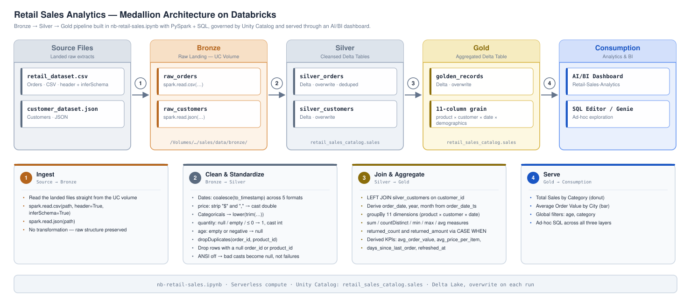
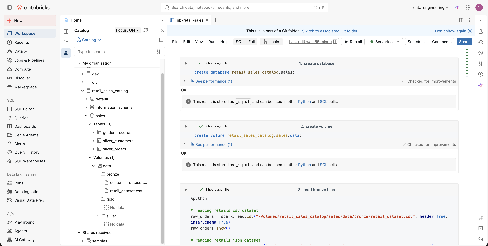
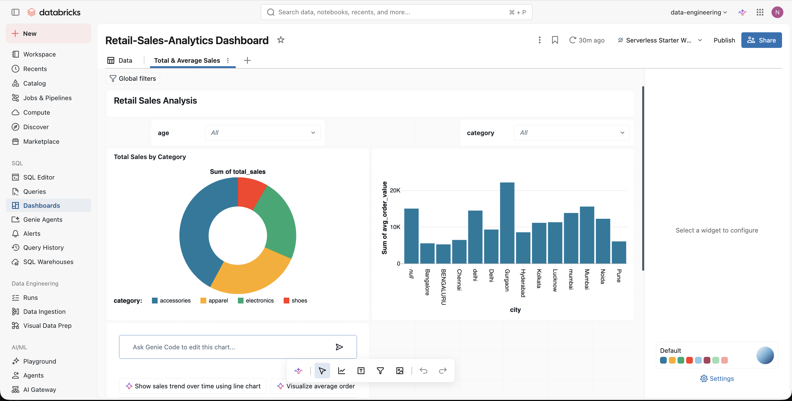

# Retail Sales Analytics Project

This project analyzes retail sales data using Databricks notebooks. The workflow is structured in three main layers: Bronze, Silver, and Gold, following the Medallion architecture.

## Architecture



> The diagram is a `.drawio.svg` — it renders here and is also directly editable. Open [images/architecture.drawio.svg](images/architecture.drawio.svg) in [draw.io](https://app.diagrams.net) (**File → Open From → Device**) or with the *Draw.io Integration* VS Code extension, then save over the same file to update both the picture and its source.

## Workflow Overview

1. **Catalog, Database and Volume Setup**
   - Created a Unity Catalog database (`retail_sales_catalog.sales`) and a volume to store raw data files.

2. **Bronze Layer: Ingest Raw Data**
   - Loaded orders data from CSV and customers data from JSON files in the bronze data folder.

3. **Silver Layer: Data Cleaning & Standardization**
   - Orders: Standardized order dates from multiple formats, cleaned column types, and stored as `silver_orders` table.
   - Customers: Cleaned sign-up dates, normalized column values, and stored as `silver_customers` table.

4. **Gold Layer: Enriched & Aggregated Analytics**
   - Joined orders and customers for enriched records.
   - Added temporal columns (year, month, date).
   - Aggregated analytics into the `golden_records` table for product/customer/time dimensions.

## Transformations

### Raw (Bronze) → Silver

Bronze is a straight read of the landed files — no transformation, just `spark.read` with `inferSchema=True`:

| Source file | Format | DataFrame |
| --- | --- | --- |
| `/Volumes/retail_sales_catalog/sales/data/bronze/retail_dataset.csv` | CSV | `raw_orders` |
| `/Volumes/retail_sales_catalog/sales/data/bronze/customer_dataset.json` | JSON | `raw_customers` |

**`raw_orders` → `silver_orders`**

| Column | Transformation | Why |
| --- | --- | --- |
| `order_id` | `trim` → cast `long` | Strip whitespace, enforce numeric key |
| `order_date` → `order_date_ts` | `coalesce` of `to_timestamp` across `yyyy-MM-dd`, `dd/MM/yyyy`, `d-MMM-yyyy`, `MM-dd-yyyy`, `dd-MM-yyyy` | Source mixes five date formats; first pattern that parses wins |
| `customer_id`, `customer_name`, `product_id` | `trim` | Remove padding |
| `product_name`, `category` | `lower(trim(...))` | Case-normalize so grouping doesn't split values |
| `quantity` | Null/empty → `1`; cast `int`; `<= 0` → `1` | Guarantee a usable positive quantity |
| `price` | `translate` to strip `$` and `,`, then cast `double` | Source stores price as a currency string |
| `payment_type`, `order_status`, `returned` | `lower(trim(...))` | Case-normalize categorical flags |
| `total_amount` | *derived:* `coalesce(quantity, 0) * coalesce(price, 0.0)` as `double` | Line-level revenue |

Row-level rules applied after the column work:
- `dropDuplicates(["order_id", "product_id"])` — one row per order line.
- `filter(order_id IS NOT NULL AND product_id IS NOT NULL)` — drop rows missing either key.
- Written as Delta, `mode("overwrite")` → `retail_sales_catalog.sales.silver_orders`.

`spark.sql.ansi.enabled` is set to `false` so bad casts yield `null` instead of failing the job.

**`raw_customers` → `silver_customers`**

| Column | Transformation | Why |
| --- | --- | --- |
| `customer_id`, `city` | `trim` | Remove padding |
| `gender`, `loyalty_tier` | `lower(trim(...))` | Case-normalize |
| `age` | Null/empty → `null`; cast `int`; negative → `null` | Reject impossible ages rather than keep them |
| `signup_date` | `coalesce` of `to_timestamp` across `yyyy-MM-dd`, `dd/MM/yyyy`, `d-MMM-yyyy`, `yyyy/MM/dd` | Multi-format signup dates |

Written as Delta, `mode("overwrite")` → `retail_sales_catalog.sales.silver_customers`.

### Silver → Gold

`silver_orders` **LEFT JOIN** `silver_customers` on `customer_id`, so every order survives even without a matching customer record.

Derived date parts added before aggregating:
- `order_date` = `to_date(order_date_ts)`
- `year` = `year(order_date_ts)`
- `month` = `month(order_date_ts)`

Grouped by `product_id`, `product_name`, `customer_id`, `category`, `year`, `month`, `order_date`, `gender`, `age`, `city`, `loyalty_tier`, with these aggregates:

| Measure | Expression |
| --- | --- |
| `total_sales` | `sum(total_amount)` |
| `total_quantity` | `sum(coalesce(quantity, 0))` |
| `total_orders` | `countDistinct(order_id)` |
| `min_price` / `max_price` / `avg_unit_price` | `min` / `max` / `avg` of `price` |
| `first_order_date` / `last_order_date` | `min` / `max` of `order_date_ts` |
| `returned_count` | `sum(CASE WHEN returned = 'yes' THEN 1 ELSE 0 END)` |
| `returned_amount` | `sum(CASE WHEN returned = 'yes' THEN total_amount ELSE 0.0 END)` |

Post-aggregation derived columns (each guarded against divide-by-zero):

| Column | Expression |
| --- | --- |
| `avg_order_value` | `total_sales / total_orders`, else `0.0` |
| `avg_price_per_item` | `total_sales / total_quantity`, else `0.0` |
| `days_since_last_order` | `datediff(current_date(), last_order_date)`, else `null` |
| `refreshed_at` | `current_timestamp()` — load audit stamp |

Written as Delta, `mode("overwrite")` → `retail_sales_catalog.sales.golden_records`.

## Catalog & Notebook

Unity Catalog layout — the `sales` schema holds the three pipeline tables, and the `data` volume holds the `bronze` / `silver` / `gold` folders:



## Data Exploration

- Selected and visualized silver and gold layer tables for QA and analysis.
- Calculated key metrics/KPIs using aggregates from the pipeline, including total sales, orders, items sold, returned amounts, and customer counts.

## Dashboard

A Databricks AI/BI dashboard (`Retail-Sales-Analytics Dashboard`) is built on top of the `golden_records` gold table, with global filters for `age` and `category`.



**Total & Average Sales tab**
- *Total Sales by Category* — donut chart of `SUM(total_sales)` split across accessories, apparel, electronics, and shoes.
- *Average Order Value by City* — bar chart of `SUM(avg_order_value)` per city.

## Main Notebook: nb-retail-sales

All steps above were implemented in `nb-retail-sales.ipynb` using both SQL and PySpark. Each transform and table creation is documented via code cell titles.

---

## Example Queries for Each Layer

**Bronze Layer: Raw Exploration**
```sql
SELECT * FROM retail_sales_catalog.sales.data.bronze.retail_dataset;
SELECT * FROM retail_sales_catalog.sales.data.bronze.customer_dataset;
```

**Silver Layer: Cleaned Data**
```sql
SELECT * FROM retail_sales_catalog.sales.silver_orders;
SELECT * FROM retail_sales_catalog.sales.silver_customers;
-- Filtered order data by status
SELECT * FROM retail_sales_catalog.sales.silver_orders WHERE order_status = 'completed';
-- Filtered customer data by loyalty tier
SELECT * FROM retail_sales_catalog.sales.silver_customers WHERE loyalty_tier = 'gold';
```

**Gold Layer: Aggregated Analytics**
```sql
SELECT category, SUM(total_sales) AS total_sales
FROM retail_sales_catalog.sales.golden_records
GROUP BY category;
-- Monthly sales trend
SELECT month, SUM(total_sales) AS monthly_sales
FROM retail_sales_catalog.sales.golden_records
GROUP BY month;
-- Customer-level sales aggregation
SELECT customer_id, SUM(total_sales) AS customer_sales
FROM retail_sales_catalog.sales.golden_records
GROUP BY customer_id;
-- Top products by quantity sold
SELECT product_name, SUM(total_quantity) AS quantity_sold
FROM retail_sales_catalog.sales.golden_records
GROUP BY product_name
ORDER BY quantity_sold DESC
LIMIT 10;
```


This README summarizes the current ETL flow and analytics performed for retail sales insights in Databricks.

